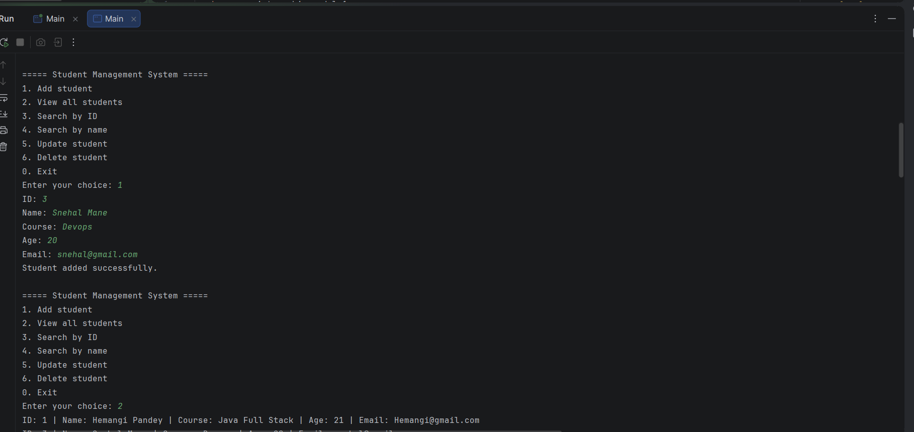
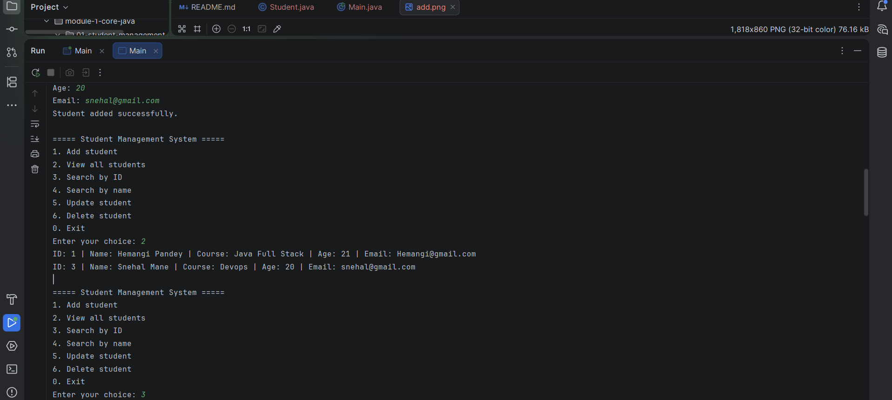
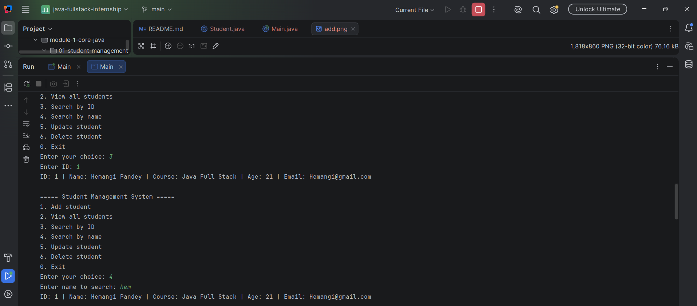
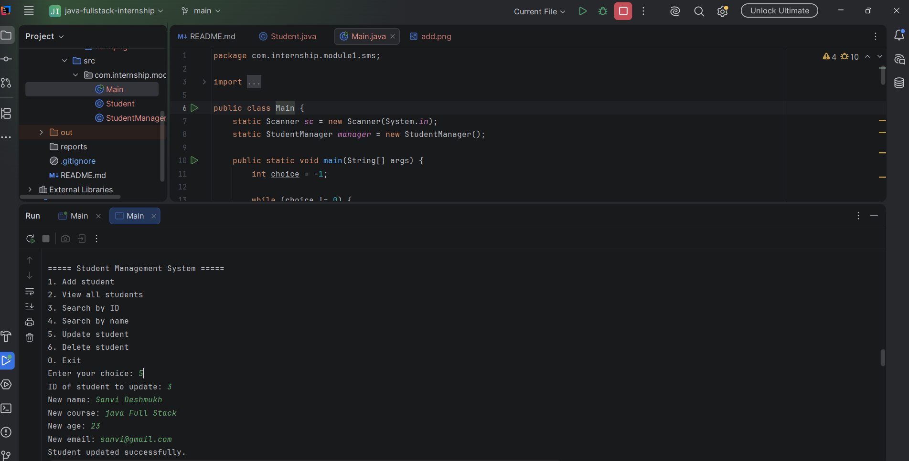
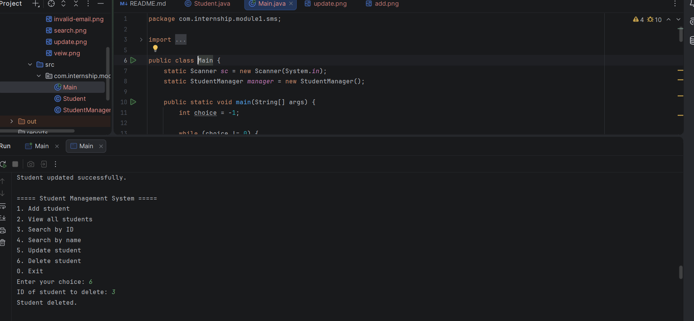
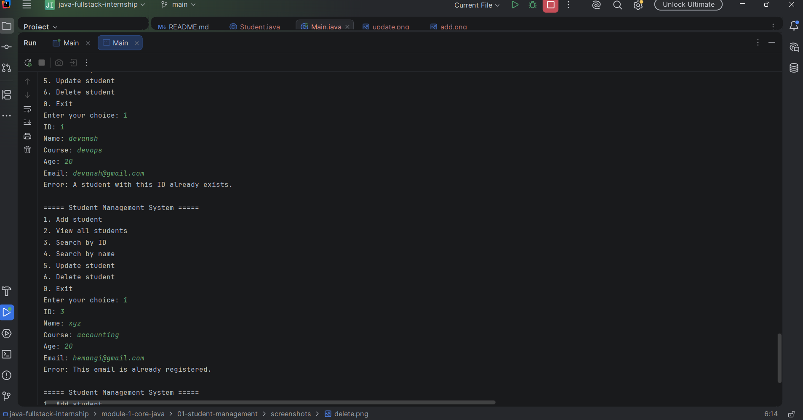
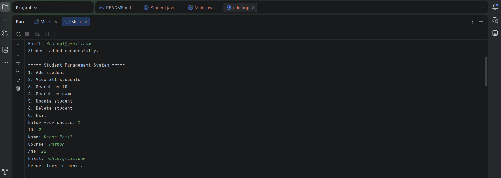

# Assignment 1: Student Management System

## Problem statement
Develop a Student Management System using classes and objects.

## Tools used
Java 17, IntelliJ IDEA, Git/GitHub

## How to run
1. Open the project in IntelliJ.
2. Run `Main.java` in `com.internship.module1.sms`.
3. Use the console menu.

## Features
Add, view, search (by ID and name), update and delete students, with validation
(age 15-100, non-empty name and course, valid email, unique ID and email).

## Sample input and output
**Add student**

**View all**

**Search**

**Update**

**Delete**

**Validation errors**

**Invalid email**

## Program logic
- `Student`: private fields, constructor, getters/setters and `toString()`.
- `StudentManager`: keeps an `ArrayList` of students; adds, searches, deletes and validates.
- `Main`: shows a menu in a `while` loop and uses `switch` to call the right method.
