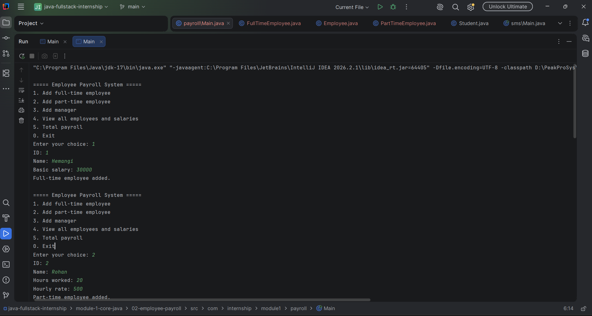
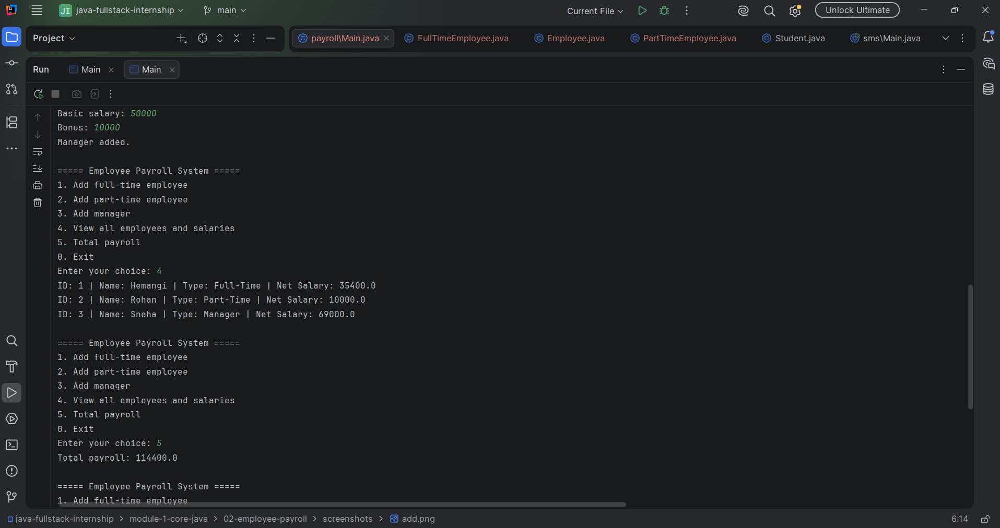
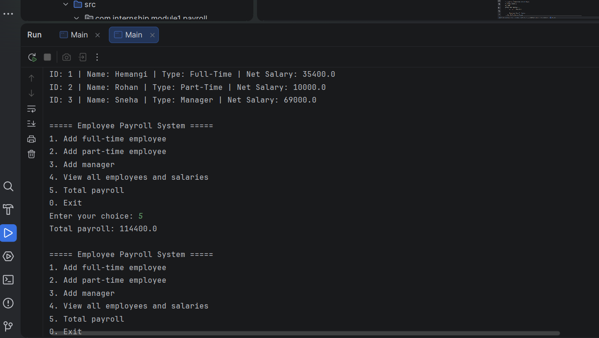
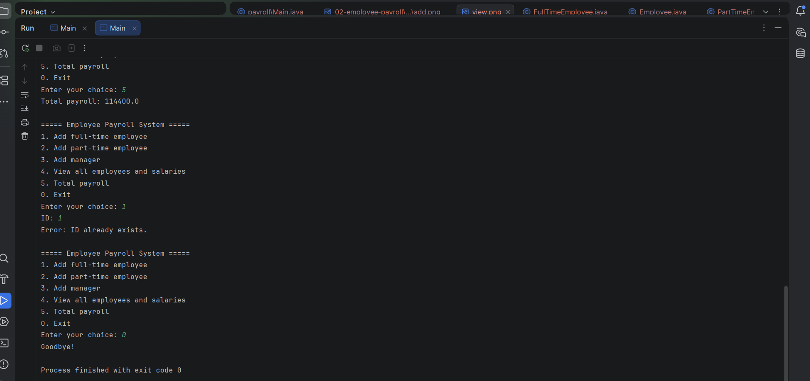

# Assignment 2: Employee Payroll System using Inheritance

## Problem statement
Create an Employee Payroll System using inheritance.

## Tools used
Java 17, IntelliJ IDEA, Git/GitHub

## How to run
1. Open the project in IntelliJ.
2. Run `Main.java` in `com.internship.module1.payroll`.
3. Use the console menu.

## Class hierarchy
- `Employee` (parent): id, name, `calculateSalary()`, `display()`
- `FullTimeEmployee extends Employee`: basic + HRA 20% + DA 10% - PF 12%
- `Manager extends FullTimeEmployee`: full-time salary + bonus
- `PartTimeEmployee extends Employee`: hours worked x hourly rate

## Sample input and output
**Add employees**

**View all**

**Total payroll**

**Duplicate ID error**

## Program logic
- Each child class uses `super(...)` to call the parent constructor.
- Each child class overrides `calculateSalary()` with its own formula.
- `Manager` reuses the full-time formula with `super.calculateSalary() + bonus`.
- One `ArrayList<Employee>` holds all employee types, and Java calls the right `calculateSalary()` at runtime (polymorphism).
