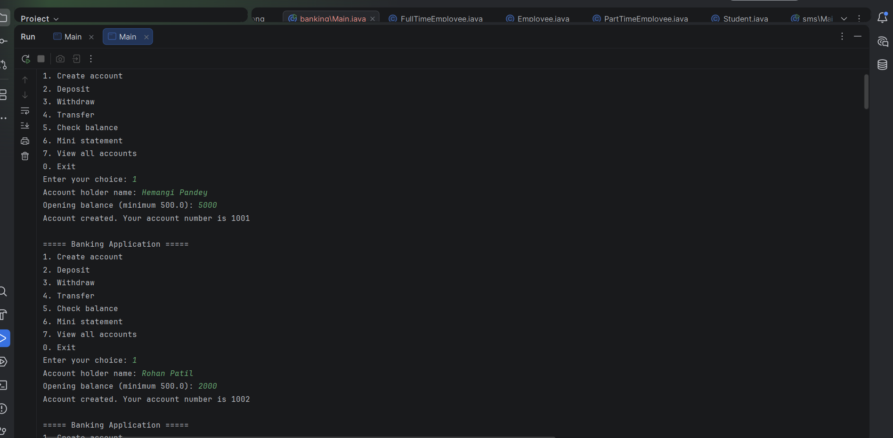
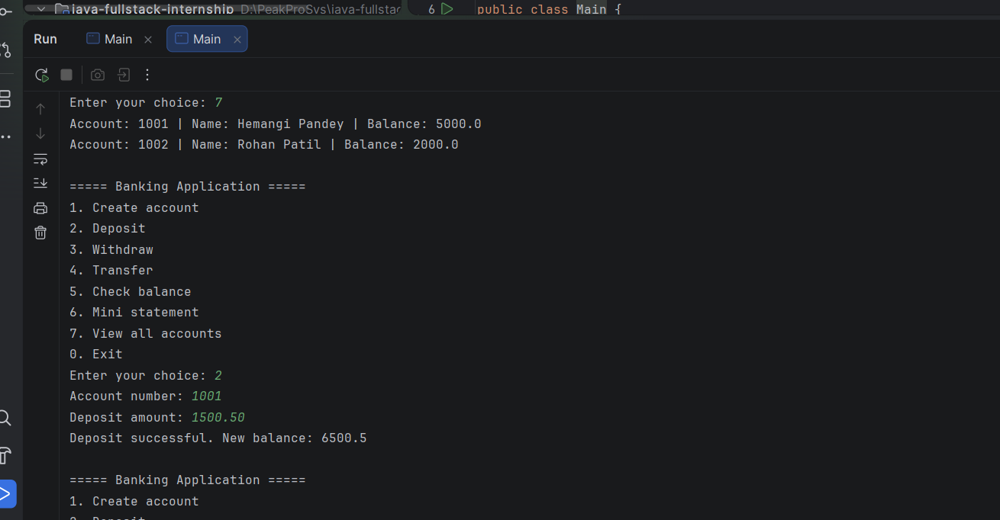
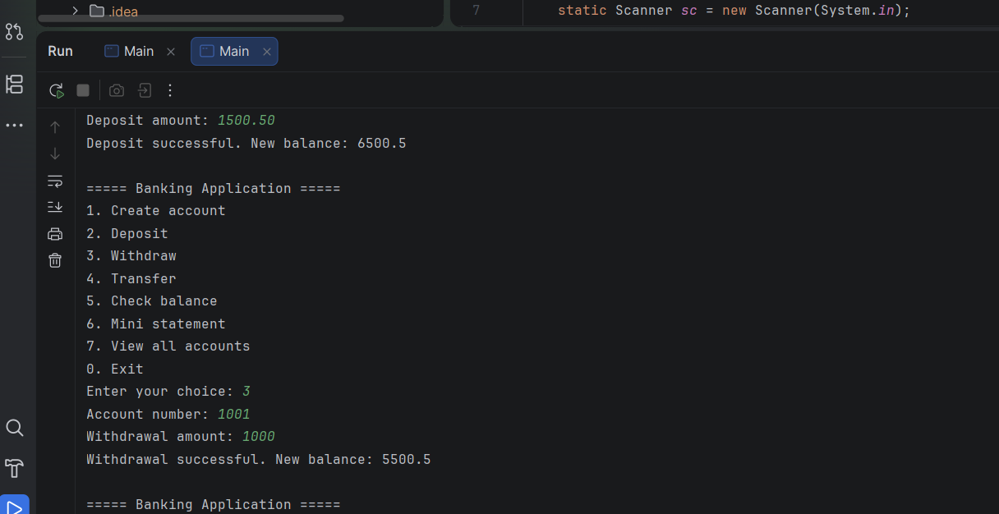
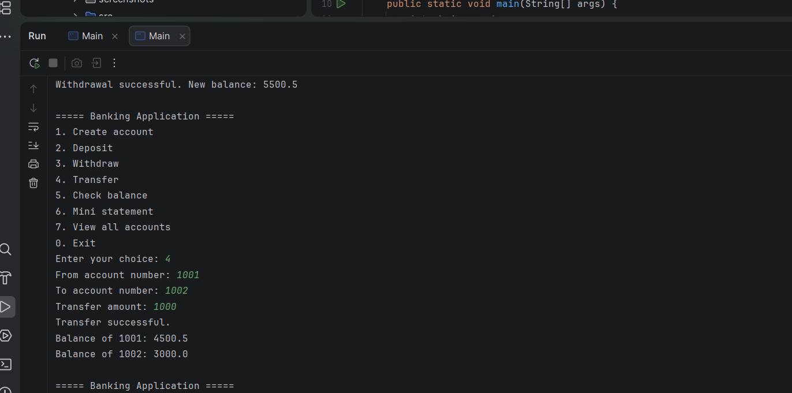
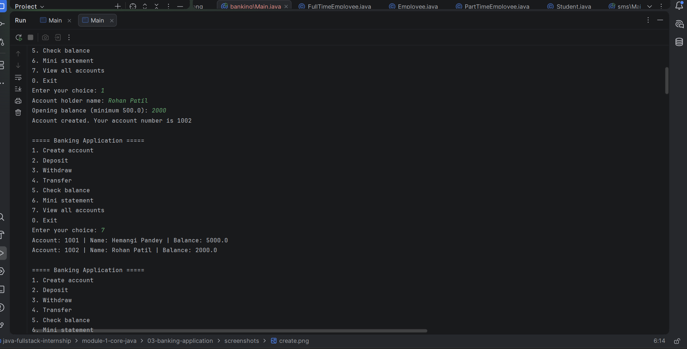
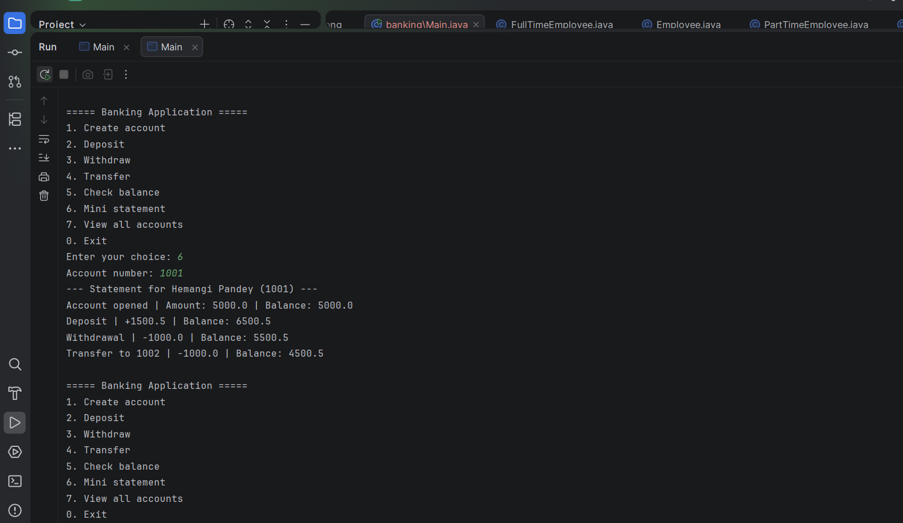

# 03 - Banking Application

Assignment 3 of the Java Full Stack Internship at PeakProSys Solutions, Pune.

A console banking application in Java that uses encapsulation. The account details are private, and the balance can only change through the account's own methods, which check the input first.

## What it does

- Create an account with a name and an opening balance
- Deposit and withdraw money
- Transfer money from one account to another
- View account details
- Print a statement of past transactions

## Rules it checks

- Name and opening balance must be valid when creating an account
- Withdrawal fails if the balance is too low
- Withdrawal is limited to 50,000
- You can't transfer to the same account
- You can't transfer to an account that doesn't exist
- Wrong input type (like text instead of a number) shows an error instead of crashing

## Code

Package: `com.internship.module1.banking`

- `Account.java` - the account and its operations
- `Bank.java` - holds the accounts and handles transfers
- `Main.java` - menu and user input

## How to run

From this folder:

```
javac -d out src/com/internship/module1/banking/Account.java src/com/internship/module1/banking/Bank.java src/com/internship/module1/banking/Main.java
java -cp out com.internship.module1.banking.Main
```

Or just open the project in IntelliJ and run `Main`.

## Screenshots

Create account



Deposit



Withdraw



Transfer



View account



Statement



Error cases

Invalid name / opening balance


Wrong input type


Insufficient balance and withdrawal limit


Same account and unknown destination


