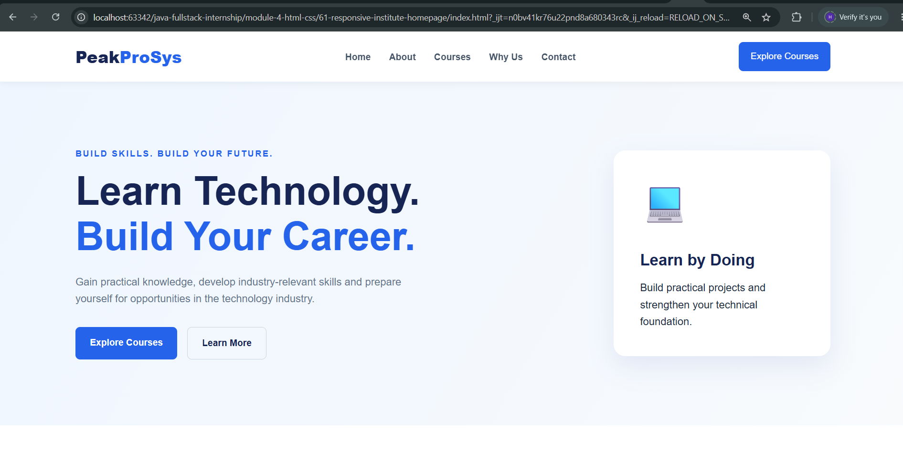
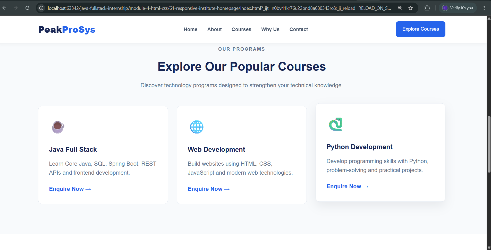
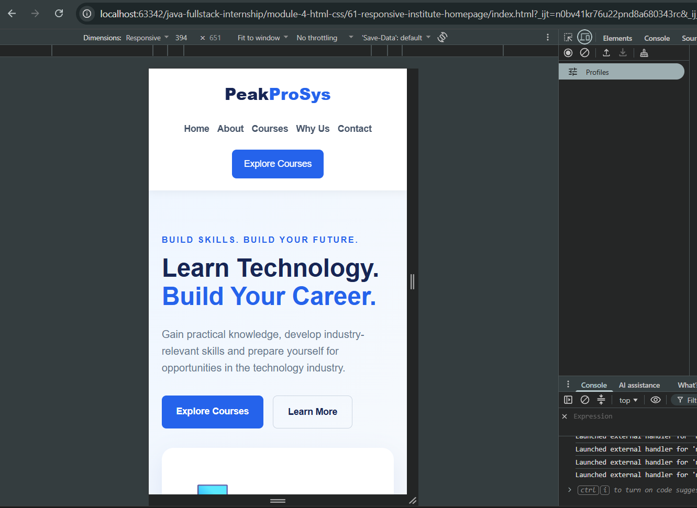

# Assignment 61 - Responsive IT Training Institute Homepage

## Overview

Developed a responsive homepage for PeakProSys Training Institute using HTML5 and CSS3. The page introduces the institute, presents its training courses and provides contact information.

## Technologies Used

- HTML5
- CSS3
- IntelliJ IDEA
- Google Chrome

## Features

- Navigation bar with links to different sections
- Hero section with a call-to-action
- About the institute section
- Course cards for Java Full Stack, Web Development and Python Development
- Why Choose Us section
- Contact section
- Responsive layout for desktop, tablet and mobile screens

## Concepts Practised

- Semantic HTML elements
- HTML links and page navigation
- CSS selectors and box model
- Flexbox and CSS Grid
- Typography, colors and spacing
- Hover effects and transitions
- Sticky positioning and smooth scrolling
- Media queries and responsive web design

## Project Structure

```text
61-responsive-institute-homepage/
├── index.html
├── style.css
├── README.md
└── screenshots/
    ├── desktop-homepage.png
    ├── courses-section.png
    └── mobile-homepage.png
```

## Screenshots

### Desktop Homepage


### Courses Section


### Mobile Homepage


## How to Run

1. Open the project folder in IntelliJ IDEA.
2. Open `index.html`.
3. Right-click and select **Open In Browser**.
4. Use Chrome Developer Tools to check the layout at different screen sizes.

## Result

Developed a responsive IT Training Institute homepage using HTML5 and CSS3.

---

**Assignment:** 61 - Responsive IT Training Institute Homepage  
**Internship:** Java Full Stack Development  
**Organization:** PeakProSys Solutions Pvt. Ltd.
