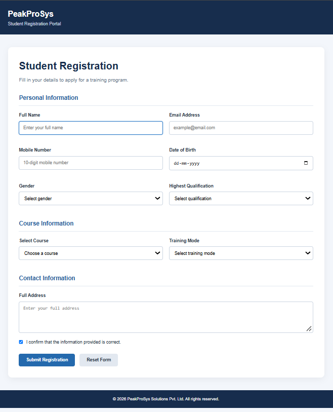
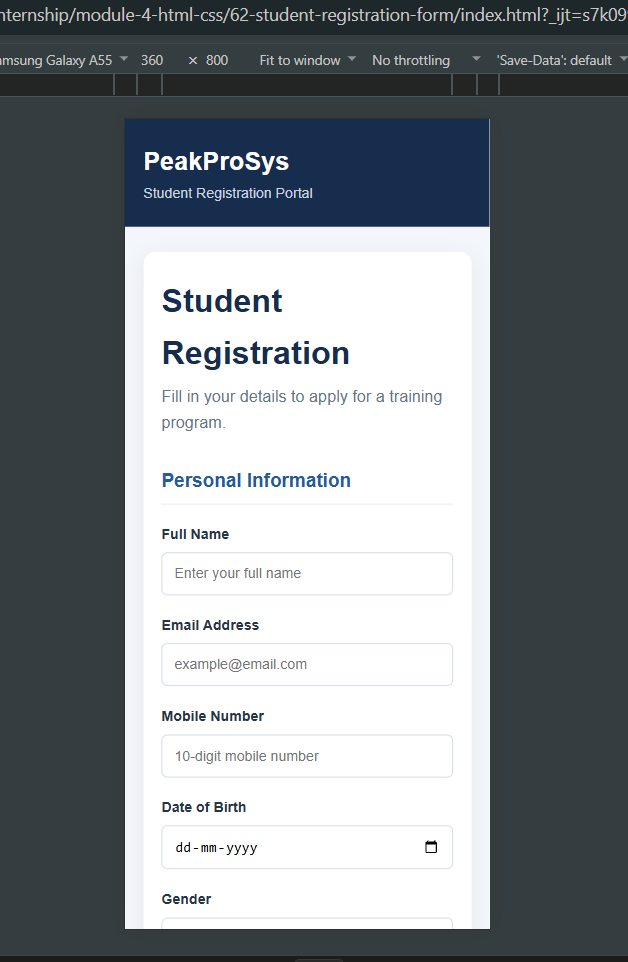

# Assignment 62 - Student Registration Form with HTML5 Validation

## Overview

Created a student registration form for PeakProSys Training Institute using HTML5 and CSS3. The form collects personal details, educational information and course preferences, with built-in HTML5 validation to check user input.

## Technologies Used

- HTML5
- CSS3
- IntelliJ IDEA
- Google Chrome

## Features

- Student personal details and contact information
- Email and mobile number validation
- Date of birth field
- Gender and qualification selection
- Course and training mode selection
- Address field
- Required terms and conditions checkbox
- Submit and Reset buttons
- Responsive layout for smaller screens

## Concepts Practised

- HTML5 form elements and input types
- Labels and form controls
- Required field validation
- Email and pattern-based validation
- Minlength and maxlength attributes
- Dropdowns, checkboxes and textareas
- CSS Grid and Flexbox
- Form styling and focus effects
- Responsive design using media queries

## Project Structure

```text
62-student-registration-form/
├── index.html
├── style.css
├── README.md
└── screenshots/
    ├── registration-form.png
    ├── validation-error.png
    └── mobile-registration.png
```

## Screenshots

### Registration Form


### HTML5 Validation


### Mobile View


## How to Run

1. Open the assignment folder in IntelliJ IDEA.
2. Open `index.html`.
3. Right-click and select Open In Browser.
4. Test the form in Google Chrome.

## Result

Built a responsive student registration form with HTML5 validation and CSS styling.

---

**Assignment:** 62 - Student Registration Form with HTML5 Validation  
**Internship:** Java Full Stack Development  
**Organization:** PeakProSys Solutions Pvt. Ltd.
