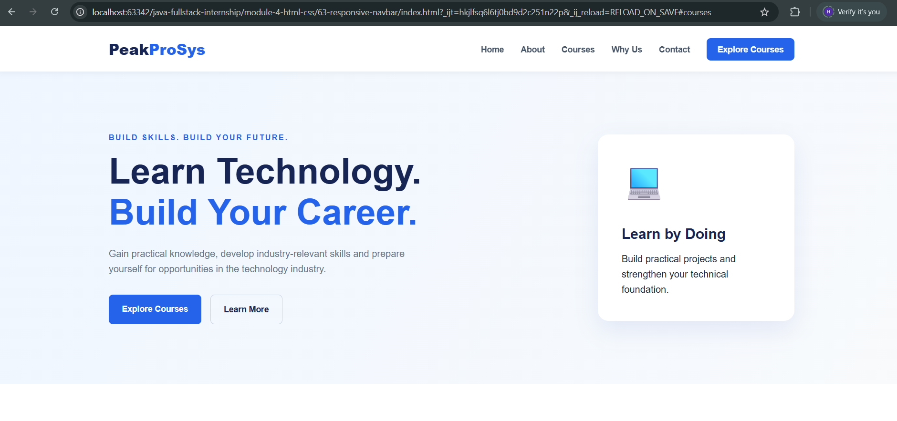
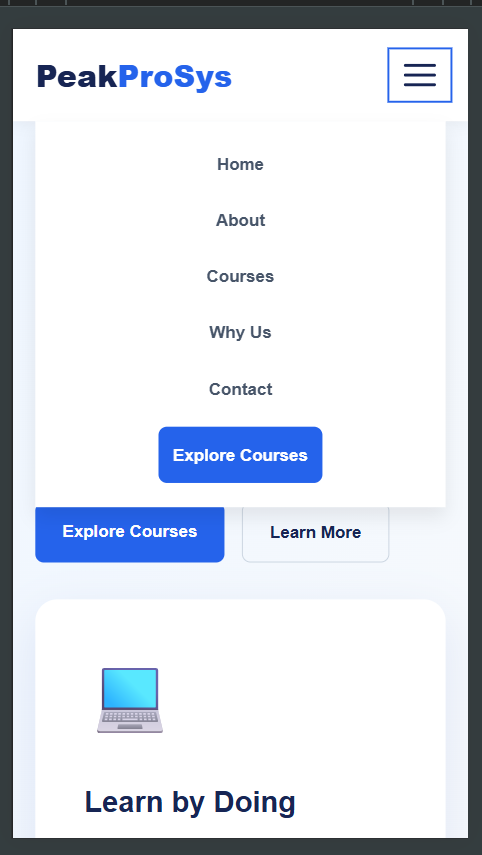

# Assignment 63 – Responsive Navigation Bar using Flexbox

## Objective

To create a responsive navigation bar using HTML5 and CSS3 Flexbox that adapts to desktop and mobile screen sizes.

## Technologies Used

- HTML5
- CSS3
- IntelliJ IDEA
- Google Chrome

## Features

- PeakProSys brand logo
- Horizontal navigation links on desktop
- Hamburger menu for mobile screens
- Explore Courses navigation button
- Hover effects on navigation links
- Sticky navigation header
- Responsive layout using CSS media queries
- CSS-based menu toggle without JavaScript

## Concepts Practised

- CSS Flexbox
- Display and positioning properties
- Justify-content and align-items
- Flex-direction and gap
- Checkbox and sibling selectors
- Hover and focus states
- Responsive media queries

## Project Structure

    63-responsive-navbar/
    ├── index.html
    ├── style.css
    ├── README.md
    └── screenshots/
        ├── desktop-navbar.png
        ├── mobile-navbar.png
        └── mobile-menu-open.png

## Screenshots

### Desktop Navigation

### Mobile Navigation

### Mobile Menu Open

## How to Run

1. Open the assignment folder in IntelliJ IDEA.
2. Open index.html in Google Chrome.
3. Resize the browser window to test different screen sizes.
4. On mobile screens, click the hamburger icon to open or close the navigation menu.

## Result

Successfully created a responsive navigation bar using CSS Flexbox and media queries. The desktop layout displays horizontal navigation links, while the mobile layout uses a CSS-based hamburger menu.

---

**Assignment:** 63 – Responsive Navigation Bar using Flexbox
**Internship:** Java Full Stack Development
**Organization:** PeakProSys Solutions Pvt. Ltd.
