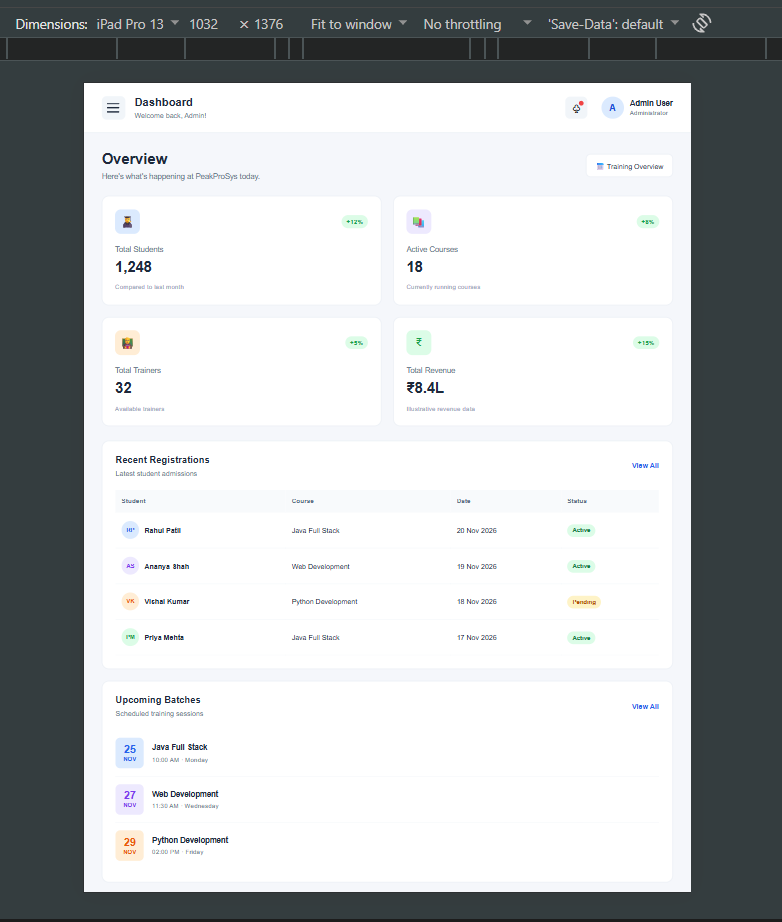
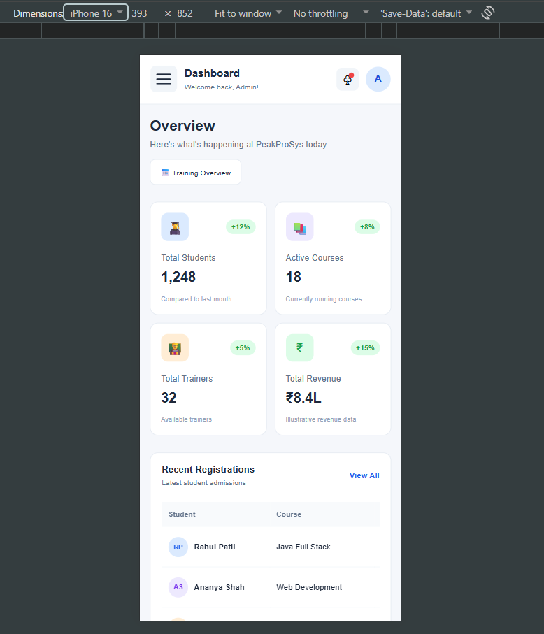

# Assignment 64 - Dashboard Layout Using CSS Grid

## 1. Overview

This assignment involves developing a responsive admin dashboard for PeakProSys Training Institute using HTML5 and CSS3.

The dashboard provides an overview of student registrations, courses, trainers, revenue, upcoming batches and course enrolment progress.

CSS Grid is used for the main page layout and dashboard sections, while Flexbox handles component alignment. Media queries make the dashboard adaptable to desktop, tablet and mobile screens.

## 2. Objectives

- Build a structured dashboard using CSS Grid.
- Use Flexbox for component alignment.
- Create reusable dashboard cards and content sections.
- Implement responsive layouts using CSS media queries.
- Develop collapsible sidebar navigation for smaller screens.
- Maintain usability across different screen sizes.

## 3. Technologies Used

| Technology | Purpose |
|---|---|
| HTML5 | Dashboard structure and content |
| CSS3 | Styling and visual presentation |
| CSS Grid | Main dashboard and card layouts |
| Flexbox | Navigation and component alignment |
| Media Queries | Responsive behaviour |
| IntelliJ IDEA | Development environment |
| Google Chrome | Browser testing |

## 4. Features Implemented

### 4.1 Sidebar Navigation

Provides navigation links for Dashboard, Students, Courses, Trainers, Reports and Settings.

- Permanent sidebar on desktop.
- Hamburger menu on tablet and mobile.
- Collapsible navigation with an overlay.
- Admin profile and logout section.

### 4.2 Dashboard Statistics

Four statistic cards display sample information about:

- Total Students
- Active Courses
- Total Trainers
- Total Revenue

### 4.3 Recent Registrations

Displays student registration records in a structured table containing student names, courses, registration dates and admission statuses.

The table supports horizontal scrolling on smaller screens.

### 4.4 Upcoming Batches

Displays upcoming training batches with their course names, schedules and timings.

### 4.5 Course Enrolment Overview

Uses visual progress indicators to represent enrolment levels for Java Full Stack, Web Development and Python Development courses.

## 5. Responsive Design

The dashboard adapts to different screen sizes using CSS Grid, Flexbox and media queries.

| Device | Tested Width | Behaviour |
|---|---:|---|
| Desktop | 1366px | Permanent sidebar and four statistic cards |
| Tablet / iPad Mini | 768px | Hamburger navigation and two-column statistics |
| Mobile | 390px | Collapsible sidebar and compact content |
| Small Mobile | 360px | Single-column statistics layout |

On tablet and mobile screens, the sidebar moves outside the main content area and opens through the hamburger menu.

## 6. Screenshots

### Desktop Dashboard

Displays the complete dashboard with permanent sidebar navigation, statistic cards, registration records and upcoming batches.


### Tablet Dashboard - iPad Mini

Shows the responsive tablet layout with hamburger navigation and adjusted dashboard sections.



### Mobile Dashboard

Shows the compact mobile layout with collapsible navigation and responsive dashboard content.



## 7. Concepts Practised

- CSS Grid and `grid-template-columns`
- `repeat()` and `minmax()`
- Flexbox alignment and spacing
- CSS media queries and breakpoints
- Fixed positioning and `z-index`
- CSS transitions and hover effects
- Checkbox-based hamburger navigation
- Responsive table overflow
- Reusable CSS classes and variables

## 8. Project Structure

```text
64-admin-dashboard/
|
|-- index.html
|-- style.css
|-- README.md
|
|-- screenshots/
    |-- desktop-dashboard.png
    |-- tablet-dashboard.png
    |-- mobile-dashboard.png
```

## 9. How to Run

1. Open the `64-admin-dashboard` folder in IntelliJ IDEA.
2. Open `index.html` in Google Chrome.
3. Open Chrome Developer Tools to test different viewport sizes.
4. Test the sidebar toggle on tablet and mobile layouts.
5. Verify the dashboard sections and horizontal table scrolling.

No server installation or database setup is required.

## 10. Result

Successfully developed a responsive admin dashboard using HTML5 and CSS3.

The assignment demonstrates the practical use of CSS Grid, Flexbox, responsive breakpoints and collapsible navigation to organize dashboard information across desktop, tablet and mobile devices.

## 11. Implementation Note

This assignment focuses on frontend layout and responsive design. Student records, statistics, revenue figures and course information are sample demonstration data. Backend services, authentication and database integration are not included.

---

**Assignment:** 64 - Dashboard Layout Using CSS Grid  
**Program:** Java Full Stack Development Internship  
**Organization:** PeakProSys Solutions Pvt. Ltd.