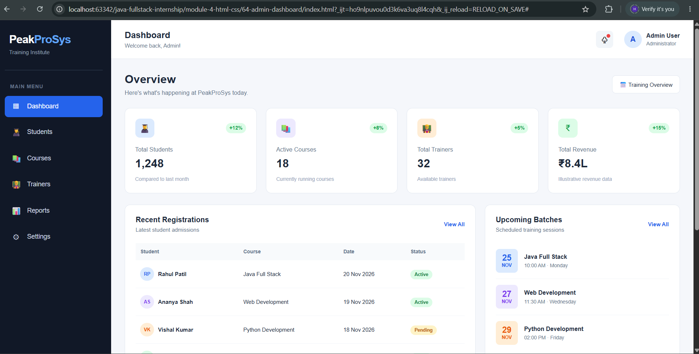

# Assignment 64 – Dashboard Layout using CSS Grid

## Overview

This assignment focuses on building a responsive admin dashboard for PeakProSys Training Institute using HTML5 and CSS3.

The dashboard provides a structured interface for viewing student registrations, course information, trainer statistics, upcoming batches and course enrolment progress.

CSS Grid is used to organize the main dashboard layout, while Flexbox handles component alignment and spacing. CSS media queries ensure that the interface adapts to desktop, tablet and mobile screen sizes.

## Objectives

- Build a structured admin dashboard using CSS Grid.
- Apply Flexbox for component alignment and layout.
- Create reusable dashboard sections and information cards.
- Implement responsive layouts using CSS media queries.
- Develop a collapsible sidebar with a hamburger menu for smaller screens.
- Maintain usability across desktop, tablet and mobile devices.

## Technologies Used

- HTML5
- CSS3
- CSS Grid
- Flexbox
- CSS Media Queries
- IntelliJ IDEA
- Google Chrome

## Features Implemented

### 1. Sidebar Navigation
- Dashboard navigation links for Students, Courses, Trainers, Reports and Settings.
- Admin profile section and Logout option.
- Permanent sidebar on desktop screens.
- Collapsible sidebar with hamburger navigation on tablet and mobile screens.
- Overlay interaction to close the sidebar.

### 2. Dashboard Statistics
Four information cards display sample data for:
- Total Students
- Active Courses
- Total Trainers
- Total Revenue

### 3. Recent Registrations
A responsive table displays sample student registration records, including student names, courses, registration dates and admission statuses.

### 4. Upcoming Batches
Displays scheduled training batches with their dates, course names and timings.

### 5. Course Enrolment Overview
Progress indicators visually represent enrolment percentages for Java Full Stack, Web Development and Python Development courses.

## Responsive Design

The dashboard uses CSS Grid, Flexbox and media queries to adapt its layout to different screen sizes.

| Screen | Width | Layout |
|---|---:|---|
| Desktop | 1366px | Permanent sidebar and four statistic cards in one row |
| Tablet / iPad Mini | 768px | Hamburger navigation and two-column statistics |
| Mobile | 390px | Collapsible sidebar and compact dashboard |
| Small Mobile | 360px | Single-column statistics layout |

On tablet and mobile screens, the sidebar moves outside the main content area and can be opened using the hamburger menu.

The registration table uses horizontal scrolling within its container to preserve its structure on smaller screens.

## Concepts Practised

- CSS Grid and grid-template-columns
- repeat() and minmax()
- Flexbox layout and alignment
- CSS media queries and responsive breakpoints
- Fixed positioning and z-index
- CSS transitions and hover effects
- Checkbox-based hamburger navigation
- Responsive table overflow
- Reusable CSS classes and variables

## Project Structure

```text
64-admin-dashboard/
│
├── index.html
├── style.css
├── README.md
│
└── screenshots/
    ├── desktop-dashboard.png
    ├── tablet-dashboard.png
    └── mobile-dashboard.png
```

## Screenshots

### 1. Desktop Dashboard

The desktop layout displays the complete sidebar navigation, dashboard statistics, registration table and upcoming batches.



### 2. Tablet Dashboard – iPad Mini

The tablet layout uses a hamburger menu instead of a permanently visible sidebar. Dashboard sections adjust to the available screen width.


### 3. Mobile Dashboard

The mobile layout provides compact statistics cards, responsive content sections and collapsible navigation.


## How to Run

1. Open the assignment folder in IntelliJ IDEA.
2. Open index.html in Google Chrome.
3. Use Chrome Developer Tools to test different screen sizes.
4. Verify the hamburger menu and responsive dashboard layout.

## Result

Successfully developed a responsive admin dashboard using CSS Grid, Flexbox and media queries.

The implementation demonstrates responsive layout design, dashboard component organization and collapsible navigation across desktop, tablet and mobile screen sizes.

**Note:** All student records, statistics, revenue figures and course information are sample demonstration data. This assignment implements the frontend layout only; it does not include backend functionality or database integration.

---

**Assignment:** 64 – Dashboard Layout using CSS Grid
**Program:** Java Full Stack Development Internship
**Organization:** PeakProSys Solutions Pvt. Ltd.
