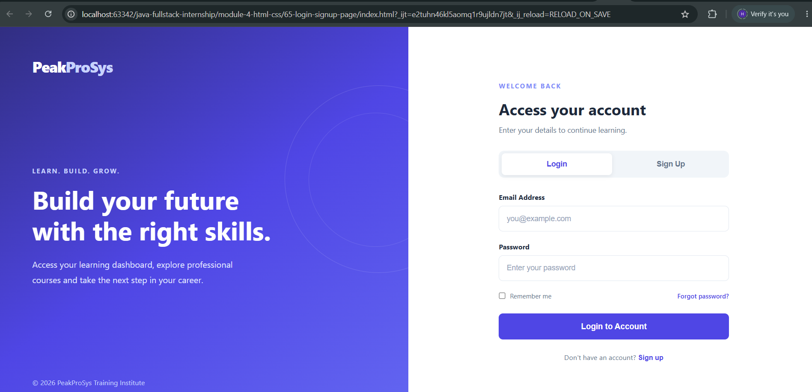
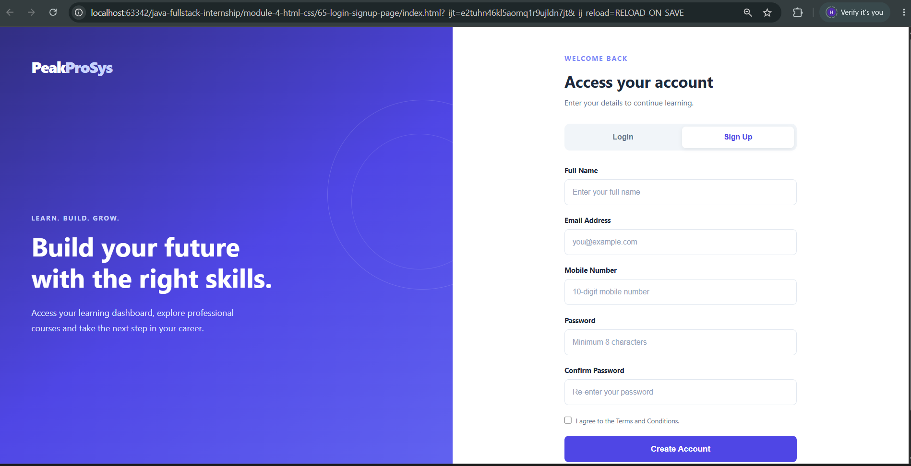
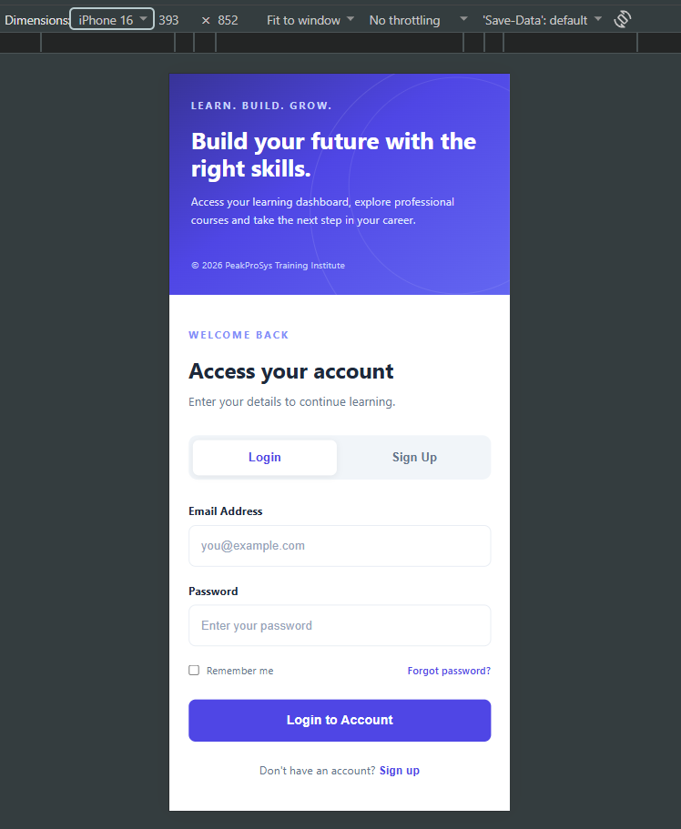

# Assignment 65 - Login/Signup Page with Modern CSS

## 1. Overview

This assignment focuses on developing a modern, responsive Login and Signup interface for PeakProSys Training Institute using HTML5, CSS3 and JavaScript.

The application provides login and registration forms on a single page. Users can switch between the forms using navigation tabs and links.

The interface features a split-screen layout, modern form styling, responsive design and client-side validation.

## 2. Objectives

- Design a modern login and registration interface.
- Create structured forms using HTML5.
- Apply modern CSS styling and layout techniques.
- Implement responsive layouts for desktop, tablet and mobile.
- Enable navigation between Login and Signup forms.
- Validate user input using HTML5 and JavaScript.
- Display feedback during form submission.

## 3. Technologies Used

| Technology | Purpose |
|---|---|
| HTML5 | Page structure and form elements |
| CSS3 | Styling and responsive layouts |
| JavaScript | Form switching and client-side validation |
| CSS Grid | Split-screen layout |
| Flexbox | Component alignment |
| Media Queries | Responsive behaviour |
| IntelliJ IDEA | Development environment |
| Google Chrome | Browser testing |

## 4. Features Implemented

### 4.1 Login Form

The login form includes:

- Email address
- Password
- Remember Me checkbox
- Forgot Password link
- Login button

### 4.2 Signup Form

The registration form includes:

- Full name
- Email address
- Mobile number
- Password
- Confirm password
- Terms and Conditions checkbox
- Create Account button

### 4.3 Form Navigation

JavaScript allows users to switch between Login and Signup forms without navigating to another page.

Users can switch forms using the top navigation tabs or the links below each form.

### 4.4 Client-Side Validation

HTML5 validation attributes are used for required fields, email format, mobile number pattern and minimum password length.

JavaScript checks whether the password and confirmation password match before allowing the registration form to be submitted.

### 4.5 Responsive User Interface

CSS Grid, Flexbox and media queries adjust the interface for different screen sizes.

### 4.6 Form Submission Feedback

JavaScript prevents the default form submission and displays a confirmation message for demonstration purposes.

## 5. Responsive Design

The page uses responsive breakpoints to adapt the layout to different devices.

| Screen | Width | Layout |
|---|---:|---|
| Desktop | 1366px | Two-column welcome and authentication panels |
| Tablet | 768px | Adjusted two-column layout |
| Mobile | 390px | Vertically stacked welcome and form panels |
| Small Mobile | 380px and below | Compact spacing and typography |

## 6. Screenshots

### 6.1 Login Page - Desktop

Displays the welcome panel and login form in a two-column desktop layout.



### 6.2 Signup Page - Desktop

Displays the registration form with personal details, contact information, password fields and terms acceptance.



### 6.3 Login Page - Mobile

Displays the responsive login interface with vertically stacked sections on a mobile viewport.



## 7. Concepts Practised

- HTML5 form elements and labels
- Input types and validation attributes
- CSS Grid and Flexbox
- CSS variables and linear gradients
- Form styling and focus states
- Hover effects and CSS transitions
- Responsive media queries
- JavaScript DOM manipulation
- Event listeners using `addEventListener()`
- Class manipulation using `classList`
- Form submission handling
- `preventDefault()`
- Custom validation using `setCustomValidity()`

## 8. Project Structure

```text
65-login-signup-page/
|
|-- index.html
|-- style.css
|-- script.js
|-- README.md
|
|-- screenshots/
    |-- login-desktop.png
    |-- signup-desktop.png
    |-- login-mobile.png
```

## 9. How to Run

1. Open the `65-login-signup-page` folder in IntelliJ IDEA.
2. Open `index.html` in Google Chrome.
3. Click the Login and Signup tabs to switch between forms.
4. Test the navigation links below each form.
5. Enter invalid email or mobile details to test HTML5 validation.
6. Enter different passwords to verify password confirmation.
7. Resize the browser to test the responsive layout.

No backend server or database setup is required.

## 10. Result

Successfully developed a modern, responsive Login and Signup interface using HTML5, CSS3 and JavaScript.

The application supports switching between authentication forms, client-side input validation, password confirmation and responsive layouts across desktop and mobile devices.

## 11. Implementation Note

This assignment demonstrates frontend authentication interface design and client-side form interactions only.

The login and registration forms do not connect to a backend service. No user accounts are created, and no actual authentication or password storage is implemented.

---

**Assignment:** 65 - Login/Signup Page with Modern CSS

**Program:** Java Full Stack Development Internship

**Organization:** PeakProSys Solutions Pvt. Ltd.