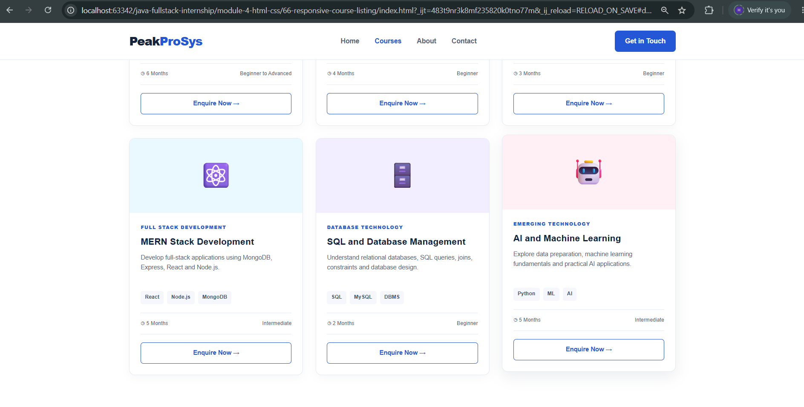
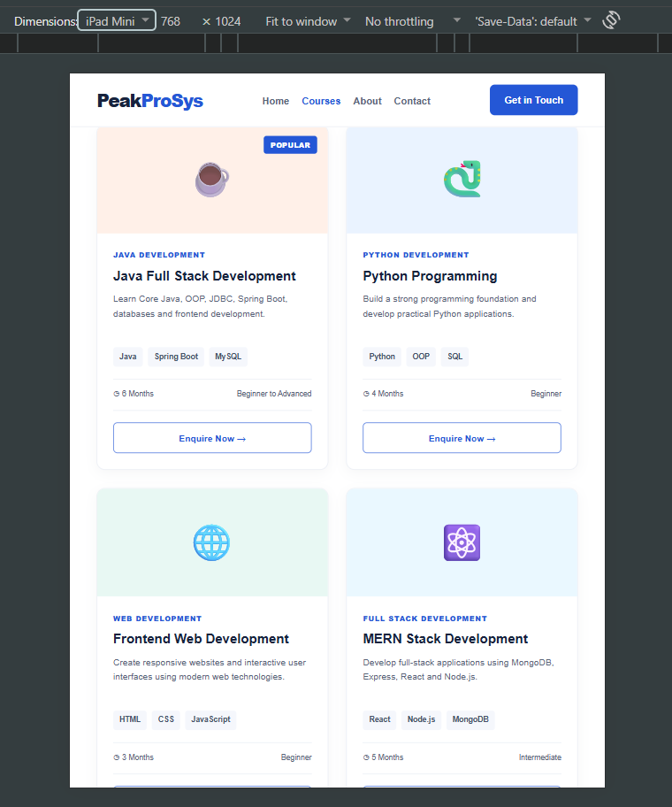
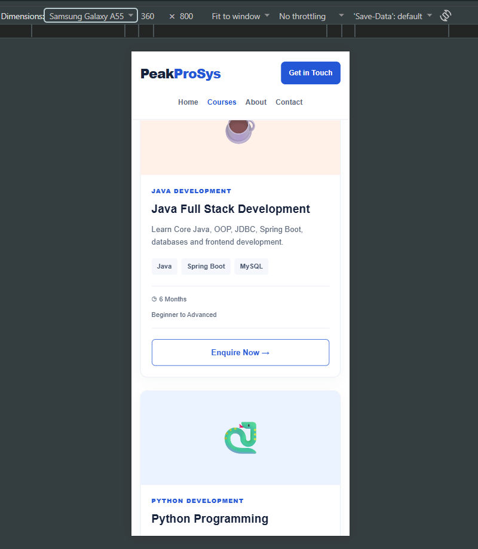

# Assignment 66 - Responsive Course Listing Page

## 1. Project Overview

The Responsive Course Listing Page is a frontend webpage developed for PeakProSys Solutions Pvt. Ltd. The application presents IT training programs in a structured and user-friendly course catalogue.

Visitors can explore different technology courses, review their descriptions, understand the listed duration and difficulty level, and navigate to the enquiry section.

The page is built using HTML5 and CSS3 with a responsive layout for desktop, tablet and mobile devices.

## 2. Problem Statement

Training institutes need an organized way to present their available courses online. A poorly structured course page can make it difficult for visitors to compare programs and find relevant information.

The objective of this assignment is to develop a responsive course listing page that displays course information through consistent card layouts and provides simple navigation to course and contact sections.

## 3. Objectives

- Develop a structured webpage using semantic HTML5 elements.
- Display multiple training programs using reusable course cards.
- Organize course information into technology categories.
- Use CSS Grid to create a responsive course layout.
- Apply Flexbox for navigation and component alignment.
- Implement media queries for different screen sizes.
- Improve the user interface with typography, spacing, colors and hover effects.
- Provide navigation links for course exploration and enquiries.

## 4. Technologies Used

| Technology | Purpose |
|---|---|
| HTML5 | Structure and content of the webpage |
| CSS3 | Styling and visual presentation |
| CSS Grid | Responsive course card layout |
| Flexbox | Navigation and component alignment |
| CSS Media Queries | Desktop, tablet and mobile responsiveness |
| CSS Transitions | Hover effects and visual feedback |

## 5. Features Implemented

### Header and Navigation
- PeakProSys branding.
- Navigation links for Home, Courses, About and Contact.
- Highlighted active Courses link.
- Get in Touch navigation button.
- Sticky header for convenient navigation.

### Hero Section
- Course discovery heading.
- Short introduction to the training programs.
- Explore Courses button linked to the course section.

### Course Catalogue
Six training programs are displayed:

1. Java Full Stack Development
2. Python Programming
3. Frontend Web Development
4. MERN Stack Development
5. SQL and Database Management
6. AI and Machine Learning

Each course card contains:
- Course title and category.
- Short course description.
- Technology tags.
- Course duration.
- Difficulty level.
- Enquiry button.

### Additional Sections
- Course category navigation links.
- About PeakProSys section.
- Contact section with an email link.
- Footer with organization information.

### Visual Design
- Consistent color scheme.
- Card-based layout.
- Rounded corners and shadows.
- Hover transitions on course cards and buttons.
- Responsive spacing and typography.

## 6. Responsive Design

CSS Grid, Flexbox and media queries are used to adapt the page to different viewport sizes.

| Device | Viewport Width | Course Layout |
|---|---:|---|
| Desktop | 1366px | Three cards per row |
| Tablet | 768px | Two cards per row |
| Mobile | 390px | One card per row |
| Small Mobile | 360px | One card per row with adjusted spacing |

The navigation, course cards, category links and contact section are adjusted for smaller screens.

## 7. Screenshots

The following screenshots demonstrate the page at different viewport sizes.

### Desktop View



### Tablet View



### Mobile View



## 8. Concepts Practised

- Semantic HTML5 elements.
- HTML navigation and anchor links.
- CSS selectors and box model.
- CSS variables.
- Flexbox layout.
- CSS Grid layout.
- Responsive media queries.
- Typography and spacing.
- Card-based UI design.
- CSS hover effects and transitions.
- Responsive website development.

## 9. Project Structure

```text
66-responsive-course-listing/
|
|-- index.html
|-- style.css
|-- README.md
|
|-- screenshots/
    |-- desktop-courses.png
    |-- tablet-courses.png
    |-- mobile-courses.png
```

## 10. How to Run the Project

1. Open the `66-responsive-course-listing` folder.
2. Open `index.html` in IntelliJ IDEA or a web browser.
3. Navigate through the course listing page.
4. Test the layout at different viewport sizes using browser developer tools.

No additional dependencies, database or backend server are required.

## 11. Testing Performed

The webpage was checked for:

- Correct loading of HTML and CSS files.
- Navigation links and section navigation.
- Display of all six course cards.
- Course card alignment and spacing.
- Hover effects on cards and buttons.
- Desktop layout.
- Tablet layout.
- Mobile layout.
- Small-screen responsiveness.

## 12. Implementation Limitations

This assignment is a static frontend implementation.

- Course category links navigate to the corresponding page sections; they do not perform dynamic filtering.
- Course information is static sample content.
- Enquiry buttons navigate to the contact section.
- No backend, database, dynamic course management or enquiry submission processing is connected.

## 13. Result

A responsive course listing webpage was successfully developed using HTML5 and CSS3. The page presents six technology training programs through structured course cards and adapts its layout to desktop, tablet and mobile screens.

The assignment provided practical experience with semantic HTML, CSS Grid, Flexbox, media queries and responsive frontend development.

---

**Assignment Number:** 66
**Assignment Title:** Responsive Course Listing Page
**Module:** 4 - HTML5 and CSS3
**Organization:** PeakProSys Solutions Pvt. Ltd.
