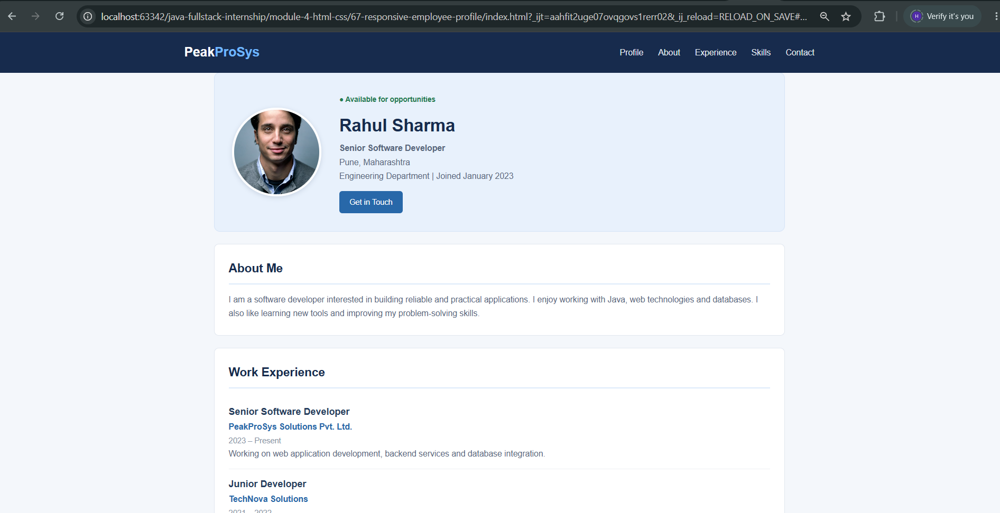
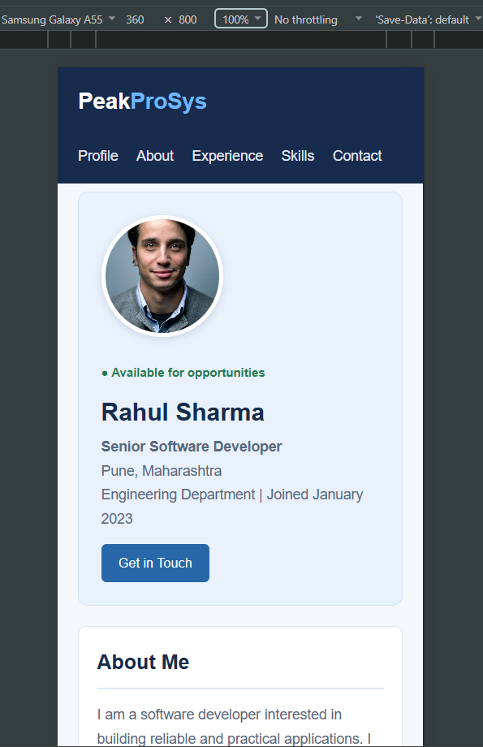
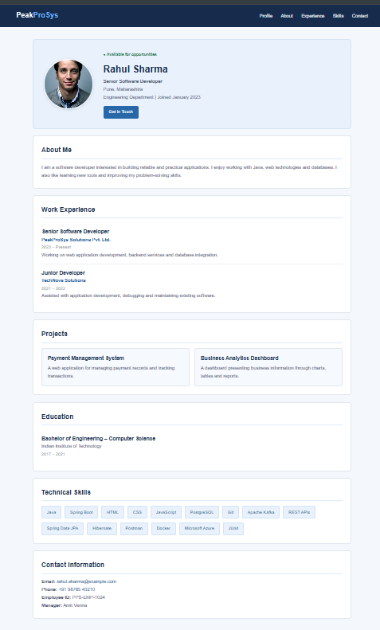

# Assignment 67 - Responsive Employee Profile Page

## 1. Objective

To design and develop a responsive employee profile webpage using HTML5 and CSS3. The page presents employee information, professional experience, projects, education, technical skills and contact details in a clear and organized layout.

## 2. Technologies Used

- HTML5
- CSS3
- CSS Flexbox
- CSS Grid
- Media Queries
- Google Chrome for browser testing

## 3. Features Implemented

- Navigation links to different profile sections
- Employee profile with a circular photograph
- Employee name, designation and department details
- About Me section
- Work experience and education details
- Project information
- Technical skills displayed as individual labels
- Clickable email and telephone links
- Smooth scrolling between sections
- Hover effects on navigation links, projects and skill labels
- Responsive layout for desktop, tablet and mobile screens

## 4. Page Structure

| Section | Description |
|---|---|
| Navigation | Links to profile sections |
| Profile | Employee photograph and basic information |
| About Me | Professional introduction |
| Work Experience | Employment details |
| Projects | Project descriptions |
| Education | Academic qualification |
| Technical Skills | Programming languages and development tools |
| Contact Information | Email, phone and employee details |
| Footer | Organization copyright information |

## 5. Responsive Design

CSS media queries are used to adjust the layout for different screen sizes.

| Device | Layout |
|---|---|
| Desktop | Horizontal navigation and profile layout |
| Tablet | Adjusted spacing and responsive profile section |
| Mobile | Stacked profile layout and wrapped navigation links |

The project section changes from two columns to one column on smaller screens.

## 6. Project Structure

```text
67-responsive-employee-profile/
|
|-- index.html
|-- style.css
|-- README.md
|
|-- screenshots/
    |-- desktop-profile.png
    |-- mobile-profile.png
    |-- employee-details.png
```

## 7. Screenshots

### Desktop View



### Mobile View



### Employee Details



## 8. How to Run the Project

1. Clone or download the internship repository.
2. Open the Assignment 67 folder.
3. Locate `index.html`.
4. Open the file in a web browser.
5. Navigate through the profile sections and test the interactive elements.

No additional dependencies or server configuration are required.

## 9. Concepts Practiced

- Semantic HTML elements
- CSS selectors and properties
- Flexbox and Grid layouts
- CSS borders, spacing and typography
- Hover transitions
- Smooth scrolling
- Responsive media queries
- Internal page navigation
- Email and telephone links

## 10. Testing

The webpage was checked in a browser at desktop and mobile screen sizes.

Navigation links, contact links, hover effects and responsive layouts were tested.

## 11. Implementation Notes

This is a frontend-only implementation. Employee information is sample data used for demonstration purposes. No backend integration, database connection or employee authentication is included.

## 12. Result

A responsive employee profile webpage was developed using HTML5 and CSS3. The page organizes professional information into clearly defined sections and provides a consistent browsing experience across different screen sizes.

---

**Internship:** PeakProSys Solutions Pvt. Ltd.

**Module:** Module 4 - HTML5 and CSS3

**Assignment:** 67 - Responsive Employee Profile Page