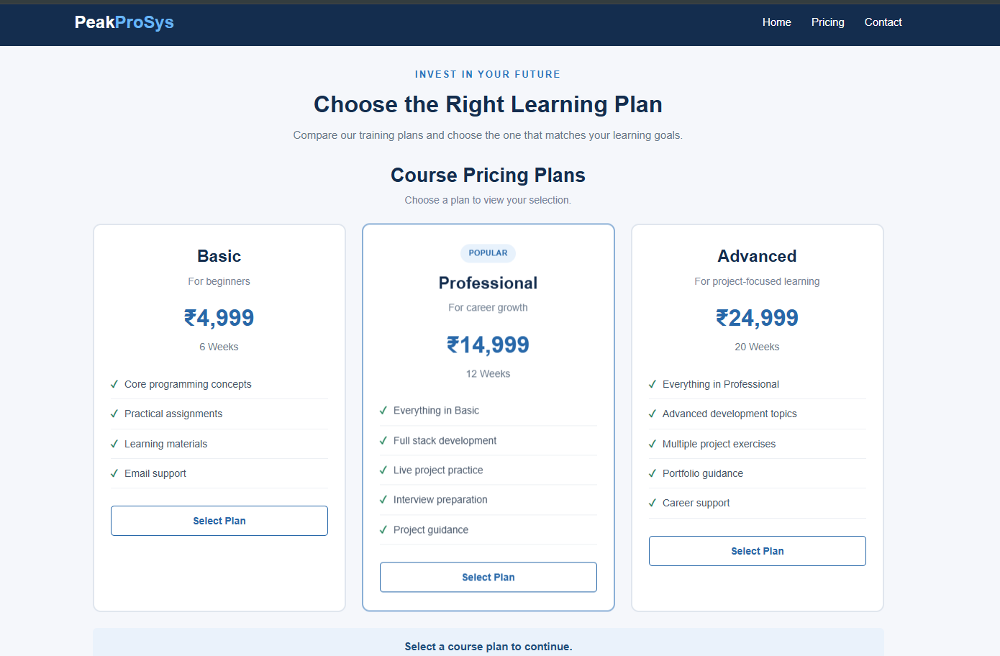
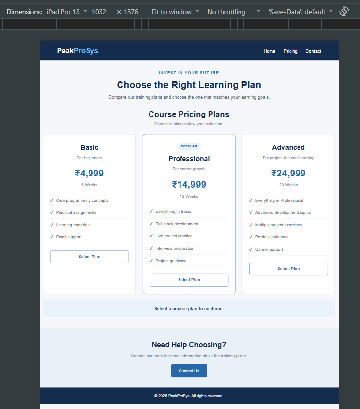

# Assignment 68: Course Pricing Comparison

## 1. Problem Statement

Design a responsive course pricing comparison page that displays multiple training plans and allows users to select a plan to view their choice.

## 2. Objective

- Create a pricing comparison interface using HTML and CSS.
- Display multiple course plans with pricing and features.
- Implement responsive layouts for desktop, tablet and mobile screens.
- Use JavaScript to handle plan selection.
- Highlight the selected pricing card visually.

## 3. Technologies Used

- HTML5
- CSS3
- JavaScript
- IntelliJ IDEA
- Google Chrome

## 4. Features Implemented

- Responsive navigation bar.
- Three pricing plans: Basic, Professional and Advanced.
- Pricing, duration and feature comparison.
- Recommended plan label.
- Interactive plan selection.
- Selected card highlighting using CSS.
- Dynamic selected-plan message using JavaScript.
- Responsive card layout using CSS Grid.
- Hover and focus effects.

## 5. Project Structure

```text
68-course-pricing-comparison/
|
|-- index.html
|-- style.css
|-- script.js
|-- README.md
|
|-- screenshots/
    |-- desktop-pricing.png
    |-- tablet-pricing.png
    |-- mobile-pricing.png
    |-- selected-plan.png
```

## 6. Screenshots

### Desktop Pricing Page



### Tablet Pricing Page



### Mobile Pricing Page


### Selected Pricing Plan


## 7. Responsive Design

| Device | Viewport Width | Layout |
|---|---:|---|
| Desktop | 1366px | Three pricing columns |
| Tablet | 768px | Two-column layout with recommended plan below |
| Mobile | 390px | Single-column layout |

## 8. Implementation Details

### HTML

Structured the page using semantic elements such as header, nav, main, section, article and footer.

### CSS

Used CSS Grid for pricing cards, Flexbox for navigation, media queries for responsive layouts, and transitions for hover and selection effects.

### JavaScript

Used DOM selection and event listeners to:

- Detect clicks on pricing plan buttons.
- Remove the previous selection.
- Highlight the newly selected card.
- Update the button text.
- Display the selected plan and its price.

## 9. How to Run

1. Open the project folder in IntelliJ IDEA.
2. Open `index.html` in a web browser.
3. Select any pricing plan.
4. Observe the selected card and confirmation message.
5. Resize the browser to test responsive behaviour.

## 10. Testing

The page was checked at desktop, tablet and mobile viewport sizes.

Plan selection was tested by selecting different pricing cards and verifying that only the latest selection remained highlighted.

## 11. Result

Successfully developed a responsive course pricing comparison page with three pricing plans and interactive selection functionality using HTML, CSS and JavaScript.

## 12. Notes

The displayed course names, fees, durations and features are sample content created for this assignment. Plan selection is a frontend interaction only; no backend processing or actual course enrolment is implemented.