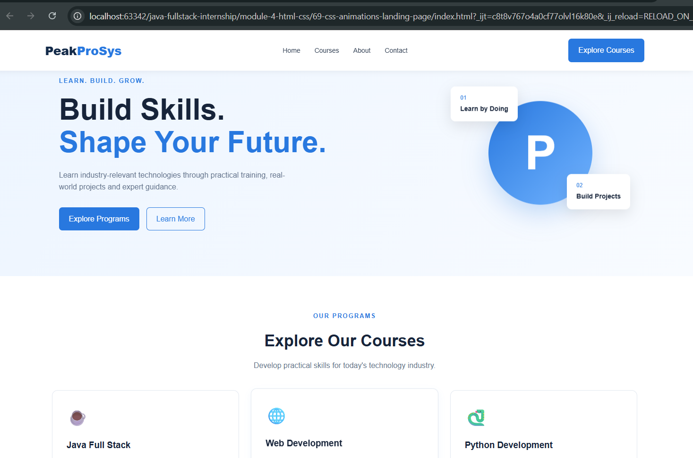
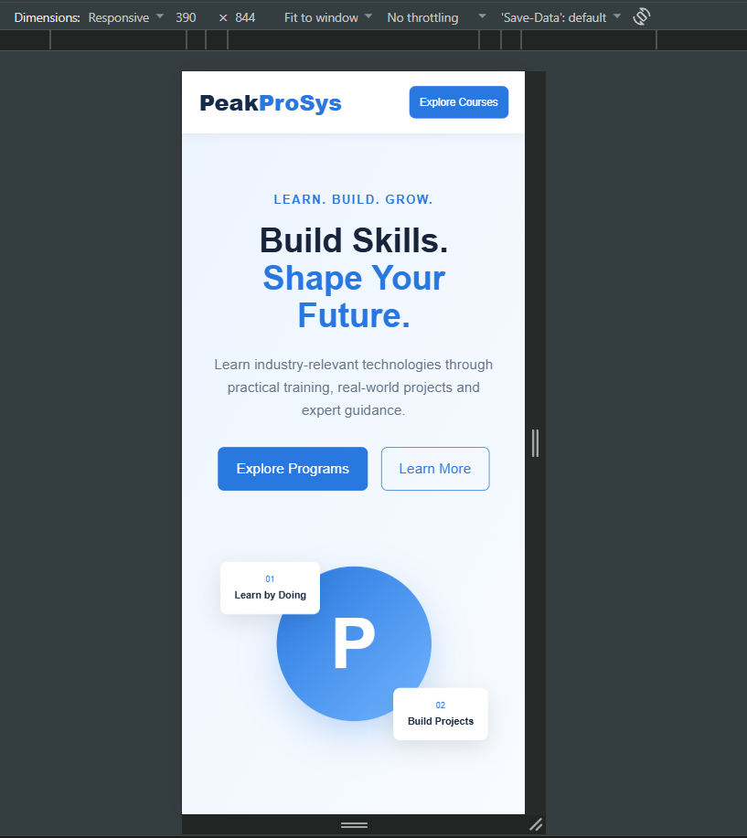
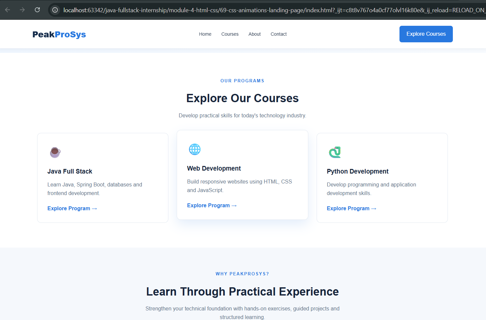

# Assignment 69 – CSS Animations Landing Page

## 1. Objective

To design and develop a responsive landing page for an IT training institute using HTML5 and CSS3. The assignment demonstrates CSS animations, transitions, transforms, and responsive layouts.

## 2. Technologies Used

- HTML5
- CSS3
- CSS Flexbox
- CSS Grid
- CSS Animations and Transitions
- CSS Media Queries

## 3. Project Structure

```text
69-css-animations-landing-page/
│
├── index.html
├── style.css
├── README.md
│
└── screenshots/
    ├── desktop-landing.png
    ├── mobile-landing.png
    └── animation-hover.png
```

## 4. Features Implemented

- Responsive IT training institute landing page.
- Navigation bar with section links.
- Hero section with animated visual elements.
- Course listing section using CSS Grid.
- About and contact sections.
- CSS keyframe animations.
- Entrance animations using slideIn and fadeIn.
- Floating animation for visual elements.
- Hover effects using CSS transitions and transforms.
- Responsive layouts using CSS media queries.

## 5. CSS Concepts Demonstrated

| CSS Concept | Implementation |
|---|---|
| @keyframes | Defines custom animation sequences |
| animation | Applies animations to page elements |
| transition | Creates smooth visual changes |
| transform | Adds movement and hover effects |
| Flexbox | Aligns navigation and content |
| CSS Grid | Structures course cards |
| Media Queries | Adapts layouts to different screen sizes |

## 6. Screenshots

### 6.1 Desktop Landing Page



### 6.2 Mobile Landing Page



### 6.3 CSS Animation and Hover Effects



## 7. Testing Performed

- Opened the landing page in Google Chrome.
- Checked the desktop layout.
- Tested the mobile layout using Chrome DevTools responsive mode.
- Verified CSS animation and hover effects.
- Captured desktop, mobile, and animation screenshots.

## 8. Learning Outcomes

- Understood how CSS keyframes define animation sequences.
- Learned the difference between animations and transitions.
- Practiced CSS transforms for interactive visual effects.
- Applied Flexbox and Grid for page layouts.
- Improved responsive design using media queries.

## 9. Limitations

- This is a frontend-only landing page.
- No backend or database integration.
- Contact and navigation sections do not implement server-side functionality.

## 10. Conclusion

Successfully developed a responsive IT training institute landing page using HTML5 and CSS3. The assignment demonstrates practical use of CSS animations, transitions, transforms, Flexbox, Grid, and responsive web design.
