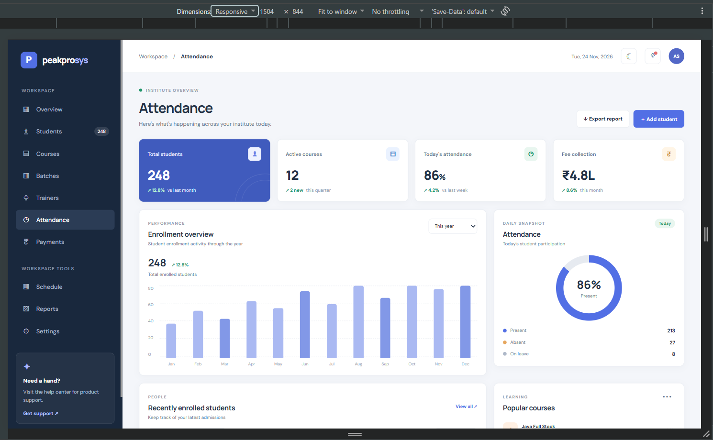
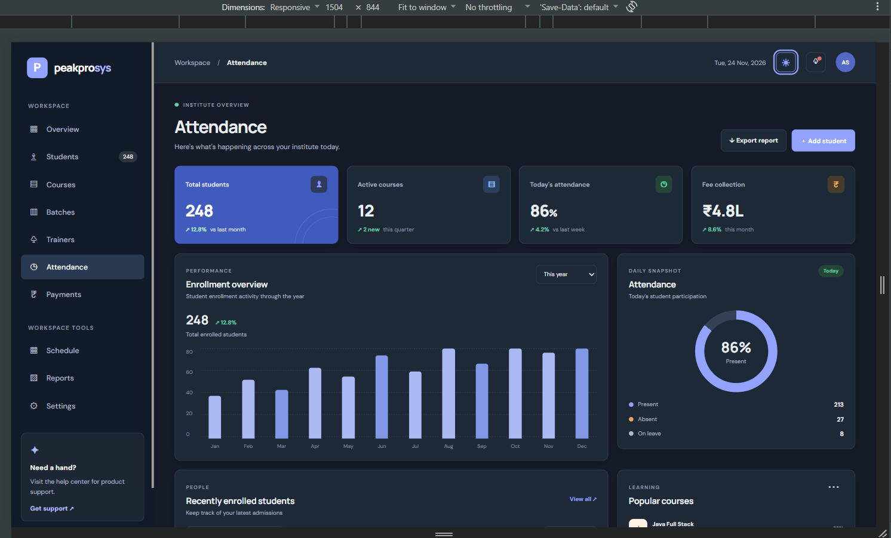
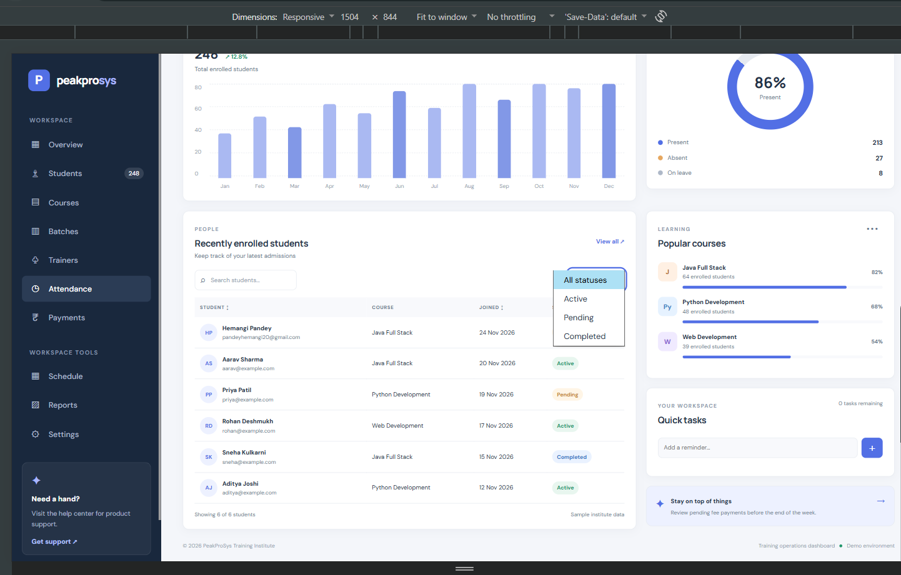
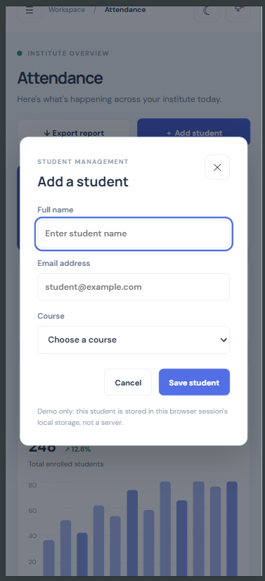
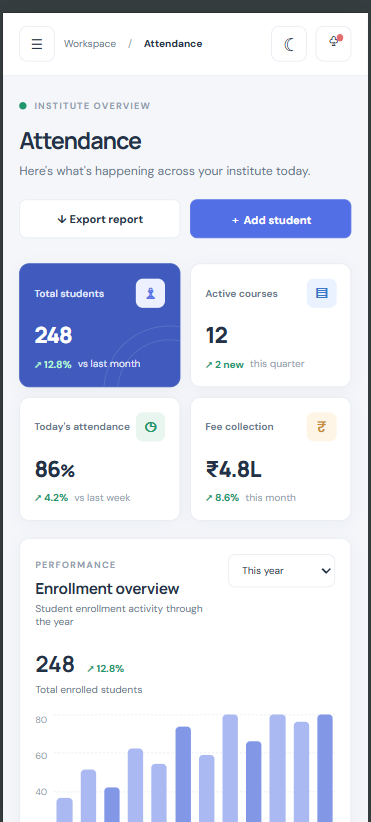
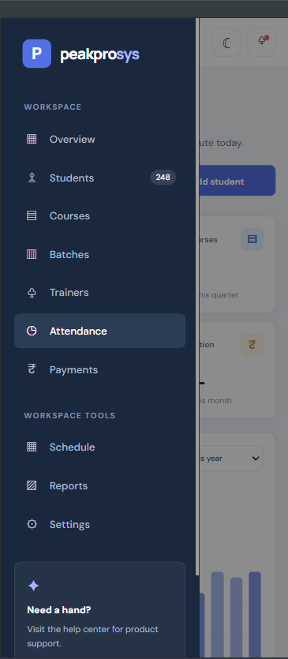
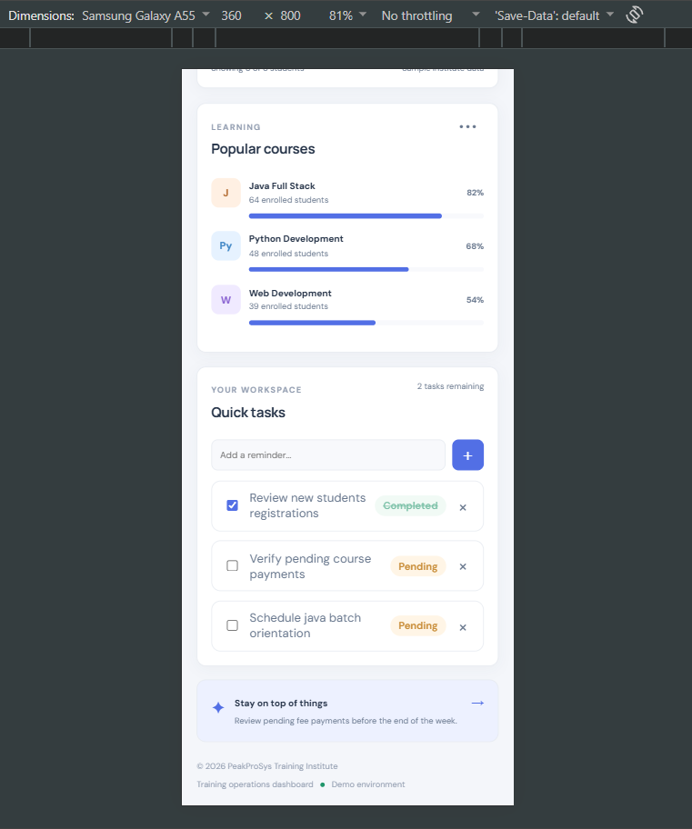

# Assignment 70 – Responsive Admin Dashboard

## Overview

A responsive Training Institute Management Dashboard developed for PeakProSys. It provides a central workspace for viewing student information, monitoring enrollment activities and managing everyday tasks.

The interface supports desktop, tablet and mobile screens with light and dark themes.

## Features

- Dashboard overview with student statistics and enrollment visuals.
- Student management table with student name, email, course, joining date and status.
- Add Student modal with form validation.
- Search students by name, email and course.
- Filter student records by enrollment status.
- Sort records by student name and joining date.
- Quick Tasks with add, complete and delete functionality.
- Pending and Completed task status indicators.
- Export student records as CSV.
- Light and dark theme switching.
- Responsive sidebar navigation for mobile screens.
- Browser localStorage for student records, tasks and theme preferences.

## Technologies Used

- HTML5
- CSS3
- JavaScript (ES6)
- CSS Grid
- Flexbox
- Media Queries
- DOM Manipulation
- Browser localStorage

## Project Structure

```text
70-responsive-admin-dashboard/
├── index.html
├── style.css
├── script.js
├── README.md
└── screenshots/
    ├── dashboard-light.png
    ├── dashboard-dark.png
    ├── student-management.png
    ├── add-student-modal.png
    ├── dashboard-mobile.png
    ├── mobile-navigation.png
    └── quick-tasks.png
```

## Screenshots

### Dashboard – Light Theme



### Dashboard – Dark Theme



### Student Management



### Add Student Modal



### Mobile Dashboard



### Mobile Navigation



### Quick Tasks



## How to Run

1. Clone or download the repository.
2. Open the assignment folder.
3. Open `index.html` in a web browser.
4. Explore the dashboard features.

No additional packages or backend setup are required.

## Implementation Details

- CSS variables maintain consistent styling and support theme switching.
- CSS Grid and Flexbox organize the dashboard layout.
- Media queries adapt the interface to different screen sizes.
- JavaScript event listeners handle user interactions.
- Array methods perform student searching, filtering and sorting.
- DOM manipulation updates student records and task lists.
- localStorage retains demo records and preferences after refreshing.

## Scope and Limitations

This is a frontend demonstration using sample student data.

- Student records and tasks are stored in browser localStorage.
- No Spring Boot backend or database is connected.
- Authentication and role-based access are not implemented.
- Dashboard statistics and charts use demonstration data.

## Learning Outcomes

Practised responsive web design, CSS Grid, Flexbox, JavaScript event handling, DOM manipulation, array methods, browser storage and interactive dashboard development.

---

**Assignment:** 70 – Responsive Admin Dashboard  
**Program:** Java Full Stack Development Internship  
**Organization:** PeakProSys Solutions Pvt. Ltd.
